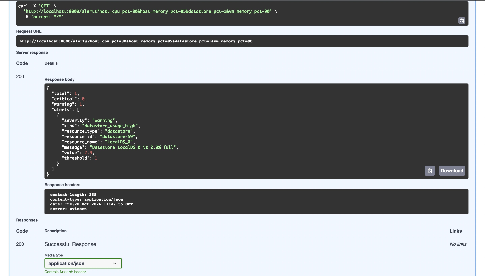
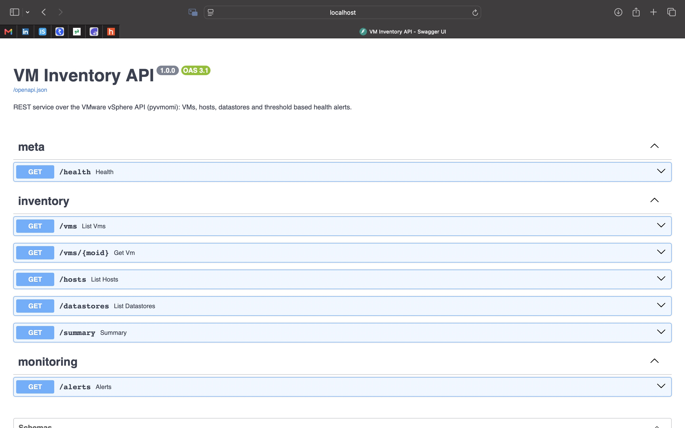

# VM Inventory API

A small REST service that reads a VMware vSphere environment through the vSphere API (pyvmomi) and exposes it as clean JSON: VMs, ESXi hosts, datastores, a one-call summary, and threshold based health alerts.

Built with Python, FastAPI and pyvmomi. It runs against a real vCenter or ESXi host, and for development against **vcsim**, the open source vCenter simulator from the govmomi project, which serves the same vSphere API.

## Screenshots





## Why this exists

Infrastructure teams often need vCenter data inside their own tools: dashboards, ticketing, automation scripts. The raw vSphere object model is verbose and slow to query one object at a time. This service shows how to wrap it behind a small, documented, testable REST API.

## What it does

| Endpoint | Description |
|---|---|
| `GET /health` | Liveness check. Does not touch vCenter. |
| `GET /vms` | List VMs. Filters: `power_state`, `host`, `name` (substring). |
| `GET /vms/{moid}` | One VM by managed object id. 404 if unknown. |
| `GET /hosts` | ESXi hosts with CPU and memory usage percentages. |
| `GET /datastores` | Datastores with capacity, free space and usage percentage. |
| `GET /summary` | Counts by power state, connected hosts, total and free storage. |
| `GET /alerts` | Powered-off VMs, disconnected hosts, inaccessible datastores, and anything over a usage threshold. Thresholds are query parameters. |

Interactive Swagger docs are generated at `/docs` and the OpenAPI schema at `/openapi.json`.

### Alert rules

- A VM that is powered off raises a warning.
- A disconnected host raises a critical alert, and its usage figures are ignored because they are meaningless.
- Host CPU, host memory, datastore usage and VM guest memory raise an alert at or above their threshold. A breach at 95% or higher is critical.
- An inaccessible datastore raises a critical alert.
- Missing statistics (for example a powered-off VM has no quick stats) never raise an error or an alert.

Defaults are 80% host CPU, 85% host memory, 85% datastore, 90% VM memory. Override per request, for example `GET /alerts?host_cpu_pct=70&datastore_pct=90`.

## Run it with Docker (recommended)

```bash
docker compose up --build
```

This starts vcsim on port 8989 and the API on port 8000.

```bash
curl http://localhost:8000/summary
curl "http://localhost:8000/vms?power_state=poweredOn"
curl http://localhost:8000/alerts
```

Open http://localhost:8000/docs for the Swagger UI.

The simulated inventory is controlled by flags on the vcsim service in `docker-compose.yml`.

## Run it locally

```bash
python -m venv .venv && source .venv/bin/activate
pip install -r requirements-dev.txt

docker run -d -p 8989:8989 vmware/vcsim     # simulator on its own
cp .env.example .env                         # then export the variables, or use your shell
uvicorn app.main:app --reload
```

There is also a command line report that needs no web server:

```bash
python scripts/list_vms.py
python scripts/list_vms.py --power-state poweredOff
```

## Point it at a real vCenter

Only configuration changes. No code changes.

```bash
export VCENTER_HOST=vcenter.example.com
export VCENTER_PORT=443
export VCENTER_USER=readonly@vsphere.local
export VCENTER_PASSWORD=...
export VCENTER_VERIFY_SSL=true
export API_KEY=choose-a-long-random-value
```

Use an account with read-only permissions. This service never changes anything in vCenter.

## Configuration

| Variable | Default | Meaning |
|---|---|---|
| `VCENTER_HOST` | `localhost` | vCenter or ESXi hostname |
| `VCENTER_PORT` | `8989` | 443 for a real vCenter, 8989 for vcsim |
| `VCENTER_USER` / `VCENTER_PASSWORD` | `user` / `pass` | vcsim defaults |
| `VCENTER_VERIFY_SSL` | `false` | Set `true` when the certificate is trusted |
| `API_KEY` | empty | When set, all endpoints except `/health` require it in the `X-API-Key` header |

## Tests

```bash
pytest -q
```

- `test_monitoring.py`: alert rules, including threshold edges and missing data.
- `test_api.py`: every endpoint, filters, 404 and 503 handling, API key auth, using an in-memory fake inventory so no vCenter is needed.
- `test_vsphere_mapping.py`: the pyvmomi layer without a vCenter. Covers conversion of vSphere data to models (powered-off VMs with no statistics, disconnected hosts), the PropertyCollector request that fetches VMs (paging, view cleanup, not-found handling), and parsing a real SOAP response through pyvmomi's own deserializer.

CI runs the same suite on every push (`.github/workflows/ci.yml`).

## Design notes

- **Provider interface.** The API depends on a small `InventoryProvider` protocol, not on pyvmomi. That is what lets the tests swap in a fake, and it would allow a Nutanix Prism backend to be added without touching the endpoints.
- **Lazy connection and reconnect.** The service connects on the first request, so it starts even while vCenter is still booting. A cheap `CurrentTime()` call detects an expired session and reconnects.
- **Thread safety.** FastAPI runs sync endpoints in a thread pool, and a pyvmomi session is not safe for concurrent use, so calls go through a lock.
- **One call for all VMs.** VM data is fetched through the vSphere PropertyCollector: a single request returns every VM with just the properties the API needs. Reading `vm.summary` and `vm.runtime` attribute by attribute would cost several round trips per VM. Host names are resolved once per listing instead of once per VM.
- **Leaf properties only.** The VM request names individual values such as `runtime.powerState` and never aggregates such as `summary` or `runtime`. The vcsim simulator sends an empty `faultToleranceState` inside a VM's runtime info, and pyvmomi cannot deserialize an empty enum value, so reading the aggregates fails with `AttributeError: summary`. Requesting leaf values avoids that field. A unit test guards this.
- **Errors.** Unreachable vCenter or bad credentials return 503 with a clear message. Unknown VM ids return 404.

## Limitations and next steps

- Reads quick statistics only. No historical performance data, so there are no trends.
- One vCenter per running instance.
- Responses are not cached, so every request queries vCenter. A short TTL cache would reduce load.
- Hosts and datastores are still read object by object. Moving them to the same single-call PropertyCollector approach would cut round trips further on large inventories.
- API key auth is a single shared key. For production use OAuth2 or put it behind an API gateway.
- A Nutanix Prism Central backend would implement the same `InventoryProvider` protocol.